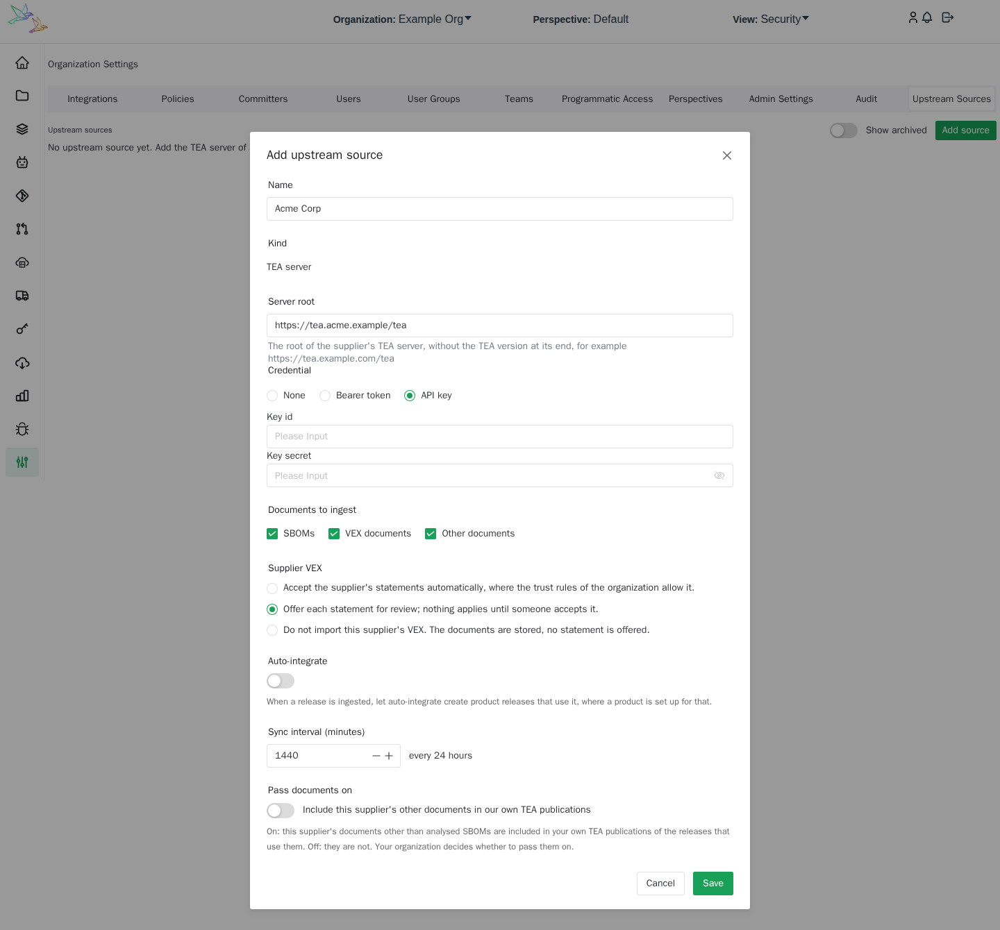
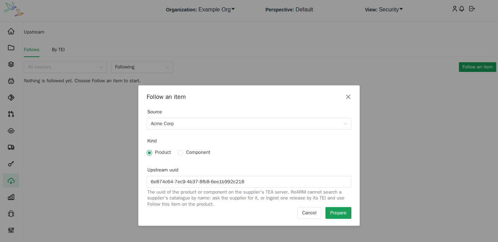
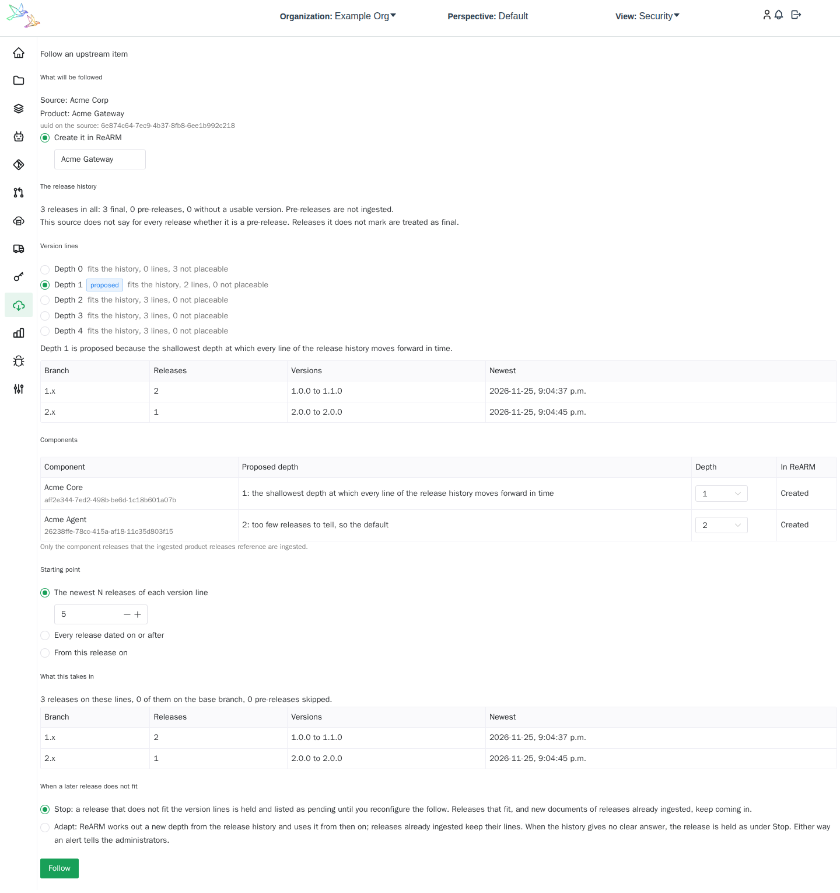
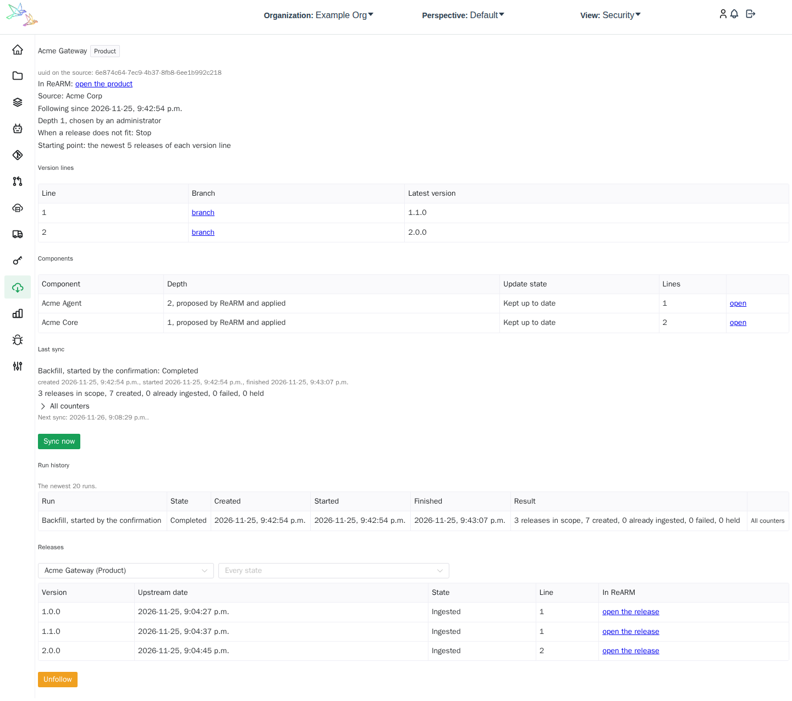
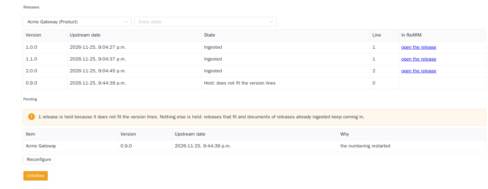
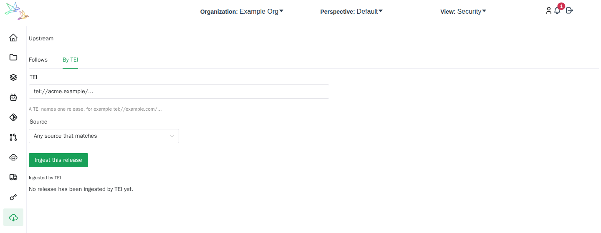
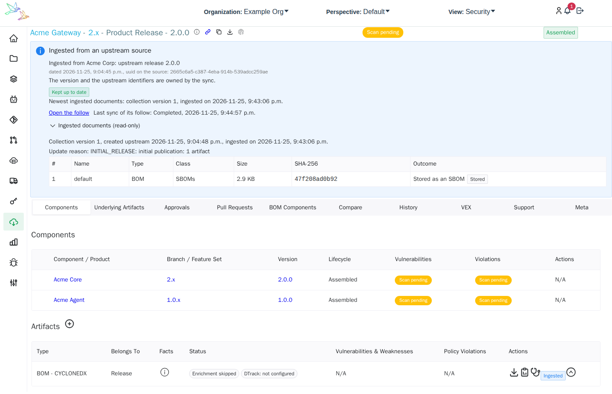

# Supplier Intake over TEA

::: warning ReARM Pro only
:::

An organization can take in what its suppliers publish over the Transparency Exchange API (TEA). It adds a supplier's TEA server as an **upstream source**, follows a product or a component on it, and ReARM ingests the supplier's releases and their documents, keeps them up to date by syncs, and holds what does not fit the version lines it settled on.

The feature has two places in the UI:

- **Organization Settings**, tab **Upstream Sources** (the last tab): the sources of the organization.
- The menu entry **Upstream**, after Secrets, with the tabs **Follows** and **By TEI**: what the organization follows, and the releases it ingested one at a time by their TEI.

Who may do what:

- An administrator of the organization adds and changes sources and follows. The buttons **Add source** and **Follow an item** show for administrators only.
- A member with read access to the whole organization sees the sources and the follows.
- A member with write access to the whole organization may ingest one release by its TEI.

This page is about the consuming side of TEA. The publishing side, how ReARM serves your own releases to others, is described on [Transparency Exchange API](/tea/).

## Before you start

Ask the supplier for:

- the root of its TEA server;
- a credential, when the server is protected;
- either the uuid of the product or component on the supplier's server, or the TEI of one release.

ReARM cannot search a supplier's catalogue by name, so the uuid or the TEI has to come from the supplier.

When the supplier runs ReARM, the root is the supplier organization's TEA API base, `<the supplier's ReARM URL>/tea/<organization TEA id>`, and the credential is an [external key](/configure/programmatic-access#external-keys-tea) of the supplier's organization, entered as an **API key** with its key id and secret.

Ask for no more than the follow needs. The credential is stored on your installation, and what it can read at the supplier is what an exposure of it would give away. So:

- ask for a credential that only reads;
- ask for one that reads only the products or components you will follow;
- ask for no credential at all when the supplier publishes them without protection, and save the source with **Credential** None.

When the supplier runs ReARM, an external key authenticates at the supplier's TEA token endpoint and is accepted nowhere else on the supplier's installation, the TEA endpoints only read, and every grant of such a key is read-only. The supplier's administrator chooses how wide the grants are: the whole organization, or single products and components. Ask the supplier for an external key whose grants name the products or components you will follow, not the whole organization. The supplier's page on [external keys](/configure/programmatic-access#external-keys-tea) describes the step **Set grants** and what each grant covers.

Two things the grants do not decide. The grants are set by the supplier: your side can neither see nor narrow them. And a grant decides only what the key reads of the supplier's private publications: what the supplier publishes as public is readable by anyone, without a key.

Every connection to a supplier's server is made by the rebom service of your installation, never by the backend, and a probe is no exception. When the installation restricts the outbound connections of rebom, a supplier's server on a private address has to be allowed by whoever installed ReARM; see [Egress Policy of the rebom Pod](/installation/rebom-egress).

When a probe reads **Fetcher not set up**, fetching from TEA servers is not set up on the installation. That is for whoever installed ReARM to fix, not for the organization.

## Upstream sources

On the tab **Upstream Sources**, **Add source** opens the dialog "Add upstream source":

| Field | What it is | Default |
|---|---|---|
| **Name** | The name of the source, up to 100 characters; the placeholder reads "The supplier's name". | empty |
| **Kind** | "TEA server", the only kind. | TEA server |
| **Server root** | The root of the supplier's TEA server. | empty |
| **Credential** | None, Bearer token or API key. | None |
| **Documents to ingest** | SBOMs, VEX documents, Other documents. | all three checked |
| **Supplier VEX** | What happens to the supplier's VEX statements (see [Supplier VEX](#supplier-vex)). | "Offer each statement for review; nothing applies until someone accepts it." |
| **Auto-integrate** | See [Auto-integrate](#auto-integrate). | off |
| **Sync interval (minutes)** | How often the source is synced, from 60 to 43200 minutes. | 1440 |
| **Pass documents on** | See [Ingested documents in your own TEA publications](#ingested-documents-in-your-own-tea-publications). | off |

The server root:

- uses https;
- is the root of the server without the TEA version at its end, for example `https://tea.acme.example/tea`;
- has no query, no fragment, no user name and no password;
- names its host by a DNS name or a plain IPv4 address, not by an IPv6 literal.

A root and a name are each unique among the sources of the organization that are not archived.

### Credentials

A bearer token is sent as it is. An API key, a key id and a secret, is exchanged at the server's token endpoint for a short-lived token; this is how the external key of a ReARM supplier works.

The credential is stored encrypted and never shown again. The list of sources shows its kind and the date it was set, and the key id to administrators only. When you edit a source you keep the credential, replace it or remove it. Changing the root of a source that holds a credential needs the credential entered again, or removed.

### Where the credential is sent

Towards the supplier, the credential goes only where the source's root covers:

- It goes only with requests whose address is under the source's root: the same scheme, host and port, and a path that is the root's own or below it. This is decided for every request, and again at every step of a redirect. The root is the one stored with the source, never something a server answers.
- It is not sent to another host, to another port of the same host, or to a path of the same host outside the root, whether an answer of the supplier's server or a redirect leads there. A redirect that leaves the root is followed without the credential.
- A document for which the supplier's server names an address of its own is fetched without the credential, at every step, even when that address is under the root. A document the server serves itself is asked for below the root and carries it.
- With an API key, the key id and the secret are sent to one address only, the token endpoint below the root, `<root>/v1.0.0/token`, once before the first request of a fetch; a redirect of that request is not followed. The token that comes back is then sent under the rule above.
- A root that is only a host name covers every path of that host; a root with a path, as a ReARM supplier's has, covers that path and what is below it.

### Documents to ingest

A document of a class that is not chosen is still listed on the release, as "Left out by the source's document choice", and is not stored.

### The probe

Saving a new source starts a probe, and so does saving a changed root or a new credential. The row action **Probe** starts one by hand. The result is in the column **Last probe**. A probe never blocks saving; the dialog has no test button.

The probe asks the server for a product that does not exist. So **Reachable** says "The server answered as a TEA server and did not reject the credential."; it does not say that the credential may read the product you will follow.

| Result | What it says |
|---|---|
| **Reachable** | "The server answered as a TEA server and did not reject the credential." |
| **Authentication failed** | "The server refused the request: it asks for a credential or rejects the stored one." With an API key the UI adds "Check the server root as well as the key: a wrong root gives the same answer." |
| **Address refused** | "The server's name leads to an address that ReARM does not connect to." See [Egress Policy of the rebom Pod](/installation/rebom-egress). |
| **Could not connect** | "No connection to the server could be opened. The name or the port may be wrong or the server may be down; the network policy of this installation may also not allow the address." See [Egress Policy of the rebom Pod](/installation/rebom-egress). |
| **Link refused** | "The server sent a redirect or a link that ReARM does not follow." |
| **Timed out** | "The server did not answer in time." The UI adds "If the server is on a private network, the network policy of this installation may block its address. Whoever installed ReARM with helm can allow it." See [Egress Policy of the rebom Pod](/installation/rebom-egress). |
| **Certificate not trusted** | "The server's TLS certificate was not accepted." |
| **Server error** | "The server answered with a server error." |
| **Not a TEA server** | "Something answered at this root, but not as a TEA server." |
| **Fetcher not set up** | "Fetching from TEA servers is not set up on this installation." |
| **Fetcher not available** | "Fetching from TEA servers is not available on this installation at the moment." |
| **Fetcher busy** | "The fetcher was busy. Probe again later." |
| **Credential unreadable** | "The stored credential can no longer be read. Enter it again." |
| **Not run** | "The probe was not run because a probe limit was reached. Probe again later." |
| **Not completed** | "The probe did not finish. Probe again." |
| **Failed** | "The probe failed." |

### The list of sources

The list has the columns Name, Server, Credential, Documents, Last probe, Sync and Actions. The arrow of a row opens **Recent syncs**. The actions are **Follows** for everyone, and **Edit**, **Probe**, **Sync now** and **Archive** for administrators.

## Following a product or a component

On **Upstream**, **Follow an item** opens a dialog with **Source**, **Kind** (Product or Component) and **Upstream uuid**. **Prepare** reads the item and its release history from the source; it creates nothing.

Reading can take a few minutes for a long history. A prepared confirmation stays usable for 30 minutes; after that, **Prepare again**.

The confirmation page **Follow an upstream item** has the sections **What will be followed**, **The release history**, **Version lines**, **Components** (for a product only), **Starting point**, **What this takes in** and **When a later release does not fit**, and the button **Follow**.

What will be followed: **Create it in ReARM** with a name, or **Adopt an existing item**. "Adopting keeps the existing item and its releases. Releases whose version the supplier also has are taken over by the follow; nothing is deleted." When a product or component of the supplier's name exists already, another name is proposed: a follow never adopts an item by its name on its own.

What a follow creates: a product for a followed product and a component for a followed component, marked as external. Each followed release becomes a release of it, with the supplier's version unchanged.

A followed product brings its components with it: the component releases that the ingested product releases reference are ingested and linked, and only those. The confirmation lists the components of the newest releases with a depth for each; "Others are followed at their proposed depth when a release references them, and an alert tells you."

After **Follow**, the follow page opens, titled by the item, with the sections **Version lines**, **Components**, **Last sync**, **Run history** ("The newest 20 runs."), **Releases** and, when something is held, **Pending**. The first run is a backfill of the starting point.

A release on the follow page is in one of these states: "Ingested", "Ingested, documents pending", "Skipped: pre-release", "Failed", "Held: does not fit the version lines". A release the supplier no longer lists reads "No longer on the source since" and its date, and is kept.

## Version lines and depth

A version line groups the releases that share the first numbers of their version; the depth is how many numbers make the line. Each line becomes a branch of the product or component, named `<line>.x`.

| Version | Depth | Line | Branch |
|---|---|---|---|
| `1.4.2` | 1 | `1` | `1.x` |
| `1.4.2` | 2 | `1.4` | `1.4.x` |
| `1.4` | 3 | `1.4.0` | `1.4.0.x` |
| `v2` | 2 | `2.0` | `2.0.x` |
| `1.4.2-rc1` | 2 | `1.4` | `1.4.x` |

Depth 0 means no version lines: "No version lines: every release goes to the base branch." A version that does not start with a number cannot be placed on a line and goes to the base branch too.

ReARM proposes a depth from the release history and preselects it with the tag "proposed"; the administrator may choose any depth from 0 to 4. For each depth the confirmation shows whether it "fits the history", "does not fit: some line would go back in time" or has "no lines", and it says why the proposal was made:

- "the shallowest depth at which every line of the release history moves forward in time";
- "too few releases to tell, so the default" (depth 2);
- "no depth fits the whole history, so the default" (depth 2);
- "the versions show no line structure" (depth 0).

One depth applies to the whole item. Within a line, the latest release is the one with the highest version by its numbers; the follow page shows it for each line as **Latest version**.

The depth of a followed item changes only through **Reconfigure**, or under Adapt (see [Drift: Stop and Adapt](#drift-stop-and-adapt)), and only for releases that come later: releases already ingested keep their lines.

## The starting point

A starting point must be chosen. Nothing is preselected, and no option takes the whole history without saying so. The three forms:

- "The newest N releases of each version line", N from 1 to 50;
- "Every release dated on or after" a day: "The day starts at 00:00 UTC.";
- "From this release on".

**What this takes in** shows how many releases the choice takes in before anything is ingested. By default at most 500 releases can be taken in at once; above that the page says "This starting point takes in N releases. At most M can be followed at once: choose a later starting point."

The starting point stays with the follow and is applied again on every sync. The follow page shows it in its header.

## Pre-releases

A release that the supplier's server marks as a pre-release is not ingested: "Pre-releases are not ingested." It is listed on the follow page as "Skipped: pre-release".

Only the supplier's mark counts, not the look of the version. When the source does not mark every release, the confirmation says "This source does not say for every release whether it is a pre-release. Releases it does not mark are treated as final."

## Syncs and updates

Each source is synced on its interval; a source with no active follow is not synced. Two buttons share the label **Sync now**: the one on a source's row in the list of sources syncs all the follows of that source, and the one on a follow page runs that follow only.

A sync brings:

- new releases that fit the starting point and the version lines;
- a new collection version of a release already ingested, with its new documents added to the release;
- the mark that a release is no longer on the source.

Nothing is deleted.

Documents: only a document whose checksum the supplier publishes, and that matches it, is kept. An SBOM is stored and analysed as an SBOM of the release, "Stored as an SBOM"; other documents are "Stored"; the rest are "Not kept", with the reason shown. An SBOM that ReARM cannot analyse, for example a CycloneDX document in XML and not in JSON, is kept as a document and shown as "Stored", with the reason that it could not be analysed as an SBOM; it adds no components and no findings to the release.

A sync that fails three times in a row raises an alert, and the next attempts are spaced further apart.

Limits of one run, by default: 500 releases, 2 GiB of documents and 120 minutes. A run that reaches one of them stops between two releases, and the next run continues: "The run reached its limit of releases. Start another run to continue." A single document over 50 MiB is not kept, by default. By hand, an organization can start 12 syncs and 12 runs an hour by default.

## Drift: Stop and Adapt

Drift is a new release that does not fit the version lines the follow settled on. The UI names three reasons: "its version cannot be placed on a version line", "the numbering restarted", "the shape of the version changed". For example, a follow at depth 1 with the lines 1 and 2 receives a release 0.9.0 published after them: the numbering restarted.

Drift is judged when a sync runs; not during the first backfill, and not for a release ingested by TEI.

The choice is made on the confirmation under **When a later release does not fit**, Stop by default:

- "Stop: a release that does not fit the version lines is held and listed as pending until you reconfigure the follow. Releases that fit, and new documents of releases already ingested, keep coming in."
- "Adapt: ReARM works out a new depth from the release history and uses it from then on; releases already ingested keep their lines. When the history gives no clear answer, the release is held as under Stop. Either way an alert tells the administrators."

A held release has no release in ReARM and no document until it is accepted.

## The pending list

When releases are held, the follow page shows **Pending**: "1 release is held because it does not fit the version lines. Nothing else is held: releases that fit and documents of releases already ingested keep coming in." (with the count of held releases), and the item, version, upstream date and reason of each; "The oldest 50 are listed." The table of follows shows the count in its column **Pending**.

**Reconfigure**, for administrators, opens "Reconfigure the follow": for each item a checkbox "Accept its held releases" and a depth.

- "Checking an item accepts its held releases. With the same depth they are accepted as they are. With another depth, that depth applies from now on; releases already ingested keep their lines."
- "A run is queued that places the accepted releases. They stay in the pending list until it has run."
- "Changing only the behaviour on drift accepts nothing and starts no run."

**Propose a depth from the history** in that dialog reads the source again and counts as a preparation: by default one at a time and 20 an hour per organization.

## One release by its TEI

The tab **By TEI** takes a TEI (`tei://...`), optionally a source ("Any source that matches" when none is chosen), and **Ingest this release**. It needs write access to the whole organization.

How it resolves: ReARM, through rebom, reads `https://<TEI domain>/.well-known/tea` and takes the server the TEI leads to. That server must already be an upstream source of the organization, matched by its root. Otherwise the request is refused with "The TEI resolved to a server that is not an upstream source of the organization.", the roots the TEI leads to are shown, and an administrator can add the server as a source and resolve the TEI again. The TEI and its well-known document are described on the TEA page, in [Hosting `.well-known/tea` on your TEI domain](/tea/#hosting-well-known-tea-on-your-tei-domain).

Which credential the lookup uses: with "Any source that matches", the well-known document and the lookup of the TEI are read without a credential; with a source chosen, that source's credential is used under the rule of [Where the credential is sent](#where-the-credential-is-sent), so the two requests carry it only when their address is under that source's root, whatever domain the TEI names.

What the tab shows while and after it works:

- "Resolving the TEI through ReARM. This takes up to two minutes."
- a choice, when the TEI names more than one release on the sources: "The choice stays open for 30 minutes."
- "The release is queued for ingestion."
- "Ingested."
- refused or failed, with one of these sentences:
  - "The TEI must be 1 to 2048 printable ASCII characters without spaces, starting with tei://."
  - "The TEI resolved to no release."
  - "The TEI resolved to a server that is not an upstream source of the organization."
  - "The server asks for a credential. Resolve the TEI again naming the source that holds it."
  - "Resolving the TEI failed."
  - "Resolving the TEI did not finish in time. Resolve it again."
  - "Resolving TEIs is busy at the moment. Resolve the TEI again later."

What it creates: the product or component of the release, if it is not in ReARM already, that one release, the component releases it references, and their documents. "Ingested once by TEI. It is frozen: only a refresh, or a follow of its product, updates it." **Refresh** fetches a later collection version of the release.

A later follow of the product takes the release over: "A follow has taken this release over. Its syncs keep it up to date." **Follow this item** on the product or component starts such a follow.

By default one TEI is resolved at a time, and 20 an hour per organization.

## What is read-only on an ingested release

The release view of an ingested release says "Ingested from" with the source and "upstream release" with the version, for example "Ingested from Acme Corp: upstream release 2.0.0", and "The version and the upstream identifiers are owned by the sync." It lists what was fetched under **Ingested documents (read-only)**, per collection version, with the outcome of each file. An ingested document carries the tag "Ingested" ("Part of the ingested snapshot: read-only"). The view of the product or component says "Ingested from an upstream source", with "Kept up to date" or "No longer updated".

Read-only:

- an ingested document: it cannot be changed, replaced, tagged, moved or removed, and no new version of it can be uploaded;
- the version of the release;
- the CPE, TEI, PURL and compliance document identifiers of the release;
- the links to component releases that the sync made;
- on the followed product or component itself: its marking as external, its type and the same identifiers.

A release adopted by a follow is covered in the same way.

Still editable: the lifecycle of the release, its tags, its approvals, and documents the organization adds itself; and the name of the product or component.

In the UI the three controls of an ingested document, "Upload New Artifact Version", "Edit Artifact Tags" and "Delete Artifact from Release", are absent rather than disabled. Through the API such a change is refused with an error that says why.

## Supplier VEX

The three options of a source:

- "Accept the supplier's statements automatically, where the trust rules of the organization allow it."
- "Offer each statement for review; nothing applies until someone accepts it." This is the default.
- "Do not import this supplier's VEX. The documents are stored, no statement is offered."

Under the first option, statements that say a finding is exploitable or in triage are accepted; statements that would suppress a finding (not affected, false positive, resolved) are offered for review; and a document that would lower what the organization already holds is offered for review as a whole. CycloneDX and OpenVEX documents are imported.

The VEX inbox has a column **Source**, and the review page says "Supplier statement from" with the source and the collection version. The review itself is described in [Importing VEX](./importing-vex).

Changing a source to the third option withdraws the proposals nobody acted on.

## Auto-integrate

Off by default, per source: "When a release is ingested, let auto-integrate create product releases that use it, where a product is set up for that."

It acts at the end of a sync only, for the newest release of each branch that the sync created. A backfill and an ingestion by TEI never trigger it. See [Bundling & Auto-Integrate](./bundling).

## Ingested documents in your own TEA publications

An ingested SBOM that ReARM analysed is an SBOM of its release like any other, so it takes part when a product that uses the release is published. This needs no setting.

The supplier's other documents are passed on only when **Pass documents on** is switched on for the source; it is off by default. "On: this supplier's documents other than analysed SBOMs are included in your own TEA publications of the releases that use them. Off: they are not. Your organization decides whether to pass them on."

Publishing is described in [Publishing releases](/tea/#publishing-releases).

## Unfollowing and archiving a source

**Unfollow** on the follow page: "Unfollow &lt;name&gt;? Nothing that was ingested is changed or deleted; it is marked as no longer updated. This cannot be undone. Following the item again needs a new confirmation, and its depth then stands as it is."

**Archive** on the source's row: "Archive &lt;name&gt;? ReARM stops syncing its follows and deletes the stored credential. Everything ingested from it stays and is marked as no longer updated. An archived source cannot be brought back; the same server can be added again as a new source."

A source is archived, not deleted: it stays in the list under **Show archived**, with its name, root and settings.

## Alerts

The administrators of the organization are told when:

- a sync held releases that do not fit;
- a follow adapted its depth;
- a followed product references a component that was not followed before (the component is then followed at its proposed depth);
- a source failed to sync three times in a row;
- an SBOM version could not be stored because another component holds its lineage.

The alerts arrive in the notification inbox, with the links "Open follow" and "Open source", and on the channels of the organization under the event type **Upstream sources**. See [Notifications](/configure/notifications).

## Automation

Every action on this page is also an operation of the GraphQL API for a signed-in user, and of the programmatic endpoint for an API key with the same permission, under the same name with `Programmatic` appended. See [Programmatic Access](/configure/programmatic-access).

## Limits of this version

- A source is a TEA server; no other kind of source can be added.
- There is no way to follow everything a supplier publishes. Each product or component is followed on its own, by its uuid on the supplier's server, and ReARM cannot list or search a supplier's catalogue. Following a product brings the component releases its releases reference, and no others.
- Pre-releases are skipped, and this cannot be switched.
- One depth applies to all version lines of an item; different lines of one item cannot have different depths.
- A source can be archived but not deleted, and an archived source cannot be brought back.
- The follow page names the latest version of each line as text, without a link to its release.
